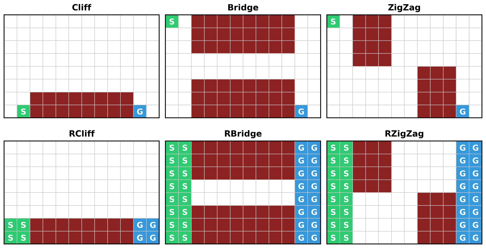

<div align="center">

# RARe: Risk-Aware Action Repetition via Expected Skip Evaluation

**Hyunwoo Park, Joonhyeok Eom, Baek-Ryun Seong, Sang-Ki Ko**

University of Seoul

*NeurIPS 2026*


[](LICENSE)

</div>

Open-loop action repetition lets an agent repeat an action for an adaptive number of steps.
TempoRL and UTE value such a skip by the greedy value of its terminal state, which assumes
perfect control right after the skip. **RARe** evaluates that state with an expectation under a
skip-evaluation policy $\pi_e$, so a skip that ends where future control is unreliable receives a
lower value:

```math
\underbrace{\sum_{k=0}^{j-1}\gamma^k r_{t+k} + \gamma^j \max_{a'} Q(s_{t+j}, a')}_{\text{TempoRL: greedy skip evaluation}}
\quad\longrightarrow\quad
\underbrace{\sum_{k=0}^{j-1}\gamma^k r_{t+k} + \gamma^j\, \mathbb{E}_{a' \sim \pi_e(\cdot \mid s_{t+j})}\big[Q^{\pi_e}(s_{t+j}, a')\big]}_{\text{RARe: expected skip evaluation}}
```

The objective recovers the greedy skip value as $\pi_e$ becomes greedy. The change itself is small:
see `SkipRunner._skip_bootstrap` in [`rare/training/skip.py`](rare/training/skip.py) and
`ContinuousRunner._skip_bootstrap` in [`rare/training/continuous.py`](rare/training/continuous.py).

This repository contains every experiment in the paper and the code that produces its tables and
figures. It contains no result files: the commands below generate all of them.

<p align="center">
  
</p>

## Contents

- [Quick start](#quick-start)
- [Installation](#installation)
- [Running one experiment](#running-one-experiment)
- [Reproducing the paper](#reproducing-the-paper)
- [Troubleshooting](#troubleshooting)
- [Repository layout](#repository-layout)
- [Citation](#citation)
- [License](#license)

## Quick start

```bash
git clone https://github.com/funny-rl/RARe.git
cd RARe
conda env create -f environment.yml
conda activate rare
python -m experiments.run --env CliffWalking --arm RARe-se --gpu 0
```

This trains RARe-se on CliffWalking with the paper's 20 seeds in about two minutes. The results are in
`runs/CliffWalking/RARe-se/`, and `evaluations.jsonl` holds the score of every checkpoint.

## Installation

The experiments need three conda environments, because their simulators require incompatible
versions. Only `rare` is needed for the Grid, MountainCar, PointMaze and Pendulum experiments.

| Environment | File | Used for |
| --- | --- | --- |
| `rare` | `environment.yml` | Training, tables and figures |
| `rare-safety` | `environment-safety.yml` | Python 3.10 process that simulates Goal and Button |
| `rare-halfcheetah` | `environment-halfcheetah.yml` | HalfCheetah and its reference scores |

```bash
conda env create -f environment.yml
conda env create -f environment-safety.yml
conda env create -f environment-halfcheetah.yml
```

Goal and Button train in `rare` and reach the unmodified Safety-Gymnasium benchmark through a
second process. Set this variable in every new shell that runs them:

```bash
export RARE_SAFETY_PYTHON=$(conda run -n rare-safety which python)
```

Check the installation:

```bash
conda activate rare
pytest tests
```

## Running one experiment

One run trains one method on one environment over all seeds, batched in a single process. Settings
come from [`configs/`](configs) and follow the paper's tables, so no other flag is needed:

```bash
python -m experiments.run --env RBridge --arm RARe-se --gpu 0
```

| Group | Environments | Arms |
| --- | --- | --- |
| Grid | `CliffWalking` `Bridge` `ZigZag` `RCliffWalking` `RBridge` `RZigZag` | `DDQN` `TempoRL` `UTE` `RARe-sh` `RARe-se` |
| Ablation | same as Grid | `RARe-sh-AE-SG` `RARe-sh-AE-SE` `RARe-se-AE-SG` `RARe-se-AE-SE` `RARe-se-AG-SG` |
| Non-stationary | `WindShift` `Random` `Episodic` `Shift1` `Shift3` `Shift5` | `UTE` `RARe-sh` `RARe-se` |
| Continuous | `MountainCar` `PointMaze` `Goal` `Button` | `DDPG` `TAAC` `TempoRL` `UTE` `RARe-sh` `RARe-se` |
| Limitation study | `Pendulum` `HalfCheetah` | `TAAC` `RARe-se` |

`RARe-se` uses a separate evaluation critic and `RARe-sh` shares the action critic. In ablation
arms, `AE` or `AG` is the action backup and `SE` or `SG` is the skip backup, with `E` expected and
`G` greedy. The remaining cells of Table 5 are `TempoRL`, `RARe-sh` and `RARe-se`.

Goal and Button run in seed shards, so start them with `experiments.reproduce`.

## Reproducing the paper

### 1. Check the pipeline

This runs every experiment except HalfCheetah for 7,000 steps, which takes about 15 minutes on
five GPUs. The scores of such short runs mean nothing, but with the same setup they equal the first
checkpoints of the full runs:

```bash
python -m experiments.reproduce all --gpus 0,1,2,3 --per-gpu 2 --stop-step 7000 --runs runs-check
```

The `paper` commands of step 3 need complete runs, so they stop on these short ones.

### 2. Run the experiments

```bash
python -m experiments.reproduce all --gpus 0,1,2,3
```

The command runs one job at a time per GPU; `--per-gpu` raises that. It skips completed runs and
restarts interrupted ones, so it can be repeated after a stop. It exits with an error that lists the
log of each failed run. The groups `grid`, `ablation`, `nonstationary`, `continuous` and `pendulum`
can also run separately, and `--dry-run` prints the commands.

Measure the cost tables on an otherwise idle GPU:

```bash
python -m tools.measure_cost run --gpu 0 --seeds 0:5
python -m tools.measure_cost report
```

Run HalfCheetah and its reference scores in the third environment:

```bash
conda activate rare-halfcheetah
python -m experiments.reproduce halfcheetah --gpus 0
python -m tools.halfcheetah_reference floor
python -m tools.halfcheetah_reference ppo --seed 0
python -m tools.halfcheetah_reference ppo --seed 1
python -m tools.halfcheetah_reference ppo --seed 2
conda activate rare
```

### 3. Generate the tables and figures

`paper.tables` reads every run, so start it after all of the commands above have finished:

```bash
python -m paper.rodr --runs runs --output results
python -m paper.tables --runs runs --output results
python -m paper.figures --runs runs --output results
```

| Paper | Source | Output in `results/` |
| --- | --- | --- |
| Tables 1-3, Figures 4-6 | `grid` | `tables/table01_grid_auc.tex` to `table03_grid_rodr.tex`, `figures/figure04_grid_reward.pdf` to `figure06_grid_rodr.pdf` |
| Table 4, Figure 7 | `continuous` | `tables/table04_continuous_auc.tex`, `figures/figure07_continuous_reward.pdf` |
| Table 5 | `grid`, `ablation` | `tables/table05_td_backup_ablation.tex` |
| Tables 6-11 | settings stored in the runs | `tables/table06_*.tex` to `table11_*.tex` |
| Tables 12-13 | parameter counts | `tables/table12_*.tex`, `table13_*.tex` |
| Tables 14-15 | `tools.measure_cost` | `tables/table14_cost_discrete.tex`, `table15_cost_continuous.tex` |
| Table 16 | `tools.halfcheetah_reference` | `tables/table16_reference_scores.tex` |
| Table 17 | `pendulum`, `halfcheetah` | `tables/table17_loop_limitation.tex` |
| Table 18 | `nonstationary` | `tables/table18_nonstationary_auc.tex` |
| Figure 1 | none | `figures/figure01_gridworlds.pdf` |
| Paired comparisons in the text | `grid`, `continuous` | `paired_comparisons.md` |

Figures 2 and 3 are illustrations and are not generated here.

### Compute

Measured on NVIDIA RTX A6000 GPUs, about 90 GPU-hours in total for the experiments:

| Group | Runs | GPU-hours | Longest run |
| --- | ---: | ---: | ---: |
| `grid` and `ablation` | 60 | 11 | 40 min |
| `nonstationary` | 18 | 1 | 10 min |
| `continuous` without Goal and Button | 12 | 7 | 3 h |
| `continuous` Goal and Button | 48 | 55 | 3.5 h |
| `pendulum` | 2 | under 1 | 10 min |
| `halfcheetah` | 2 | 18 | 10 h |

`tools.measure_cost` takes about 30 minutes, and each `tools.halfcheetah_reference ppo` seed about
5 minutes.

### What to expect

Runs are deterministic: repeating a run with the same seeds, software versions and GPU type gives
identical numbers. Compared with the runs behind the paper, rare checkpoints differ slightly in the
randomized Grid environments, where a near-tied greedy action can round the other way. Over the 30
ablation runs, 14 of 56,700 checkpoint rewards differ, and Table 5 comes out identical. On other GPUs
or versions, results should agree only statistically. Timing in Tables 14 and 15 varies with the
machine.

The random and expert reference scores in `paper/` are fixed constants, except for the HalfCheetah
scores produced by `tools/halfcheetah_reference.py`.

## Troubleshooting

| Message | Cause and fix |
| --- | --- |
| `Goal and Button need RARE_SAFETY_PYTHON` | Export the variable from [Installation](#installation) in this shell. |
| `No module named 'brax'` | HalfCheetah runs only in `rare-halfcheetah`. |
| `failed runs:` | Each listed `.log` file next to the run directory has the traceback. |
| `FileExistsError` from `experiments.run` | The output directory exists. Remove it or pass `--output`. |
| `KeyError` or `evaluation episodes have no trace` from `paper` | A run is incomplete; finish it without `--stop-step`. |
| Out of GPU memory | Lower `--per-gpu`. |

## Repository layout

```text
configs/       settings of every experiment
rare/
  agents/      DDQN, DDPG, TempoRL, UTE, RARe and TAAC updates
  envs/        Grid, non-stationary Grid, MountainCar, Pendulum, PointMaze, HalfCheetah, Safety-Gymnasium
  networks/    Q, skip, actor and critic networks
  replay/      primitive and skip replay
  training/    compiled collection and learning loops
  evaluation/  frozen-policy evaluation
  metrics/     normalized AUC, Risk and RODR
experiments/   command-line entry points
paper/         tables and figures
tools/         cost measurement and HalfCheetah reference scores
tests/         unit tests and short end-to-end runs
```

## Citation

```bibtex
@inproceedings{park2026rare,
  title     = {Risk-Aware Action Repetition via Expected Skip Evaluation},
  author    = {Park, Hyunwoo and Eom, Joonhyeok and Seong, Baek-Ryun and Ko, Sang-Ki},
  booktitle = {Advances in Neural Information Processing Systems},
  year      = {2026}
}
```

## License

Apache License 2.0. See [`LICENSE`](LICENSE), and [`licenses/`](licenses) for third-party assets.
